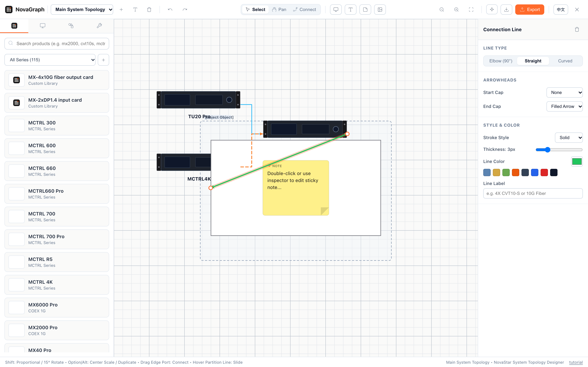
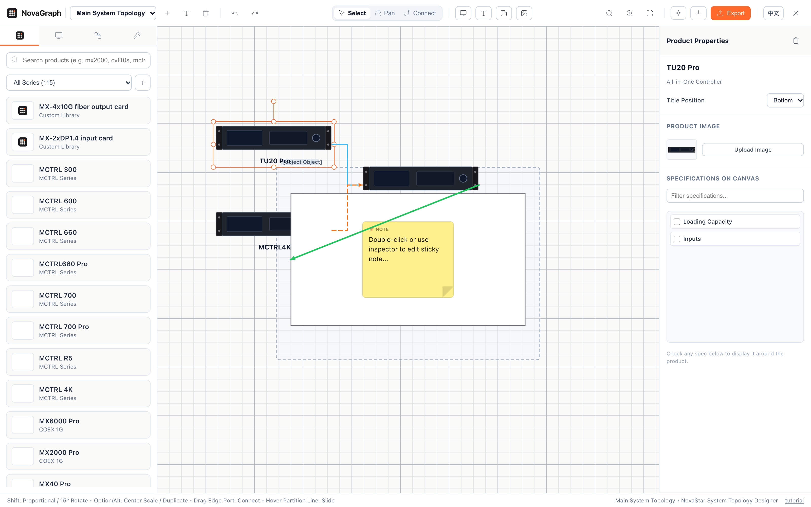

# NovaGraph

> **Codeless System Diagramming & LED Topology Design Extension for NovaStar**  
> Integrated seamlessly into [novastar.show](https://novastar.show/)

[](https://github.com/JinRecords/NovaGraph/releases)
[](https://developer.chrome.com/docs/extensions/mv3/intro/)
[](LICENSE)

---

## Introduction

**NovaGraph** is a browser extension purpose-built for AV engineers, display technicians, and system integrators. Running directly inside the **NovaStar** web portal ([novastar.show](https://novastar.show/)), NovaGraph provides an infinite diagramming canvas to architect, visualize, and document end-to-end LED display systems and video distribution topologies.

With built-in hardware specifications, realistic device chassis illustrations, intelligent magnetic port connectors, multi-cabinet LED display wall calculators, and modular H-Series splicer configurators, NovaGraph eliminates guesswork and tedious manual drafting.

---

## Screenshots

### 1. Workspace Overview
Architect complete AV topologies with NovaStar controllers, fiber converters, video processors, LED walls, and color-coded zones.



### 2. Inspector & Real-time Hardware Configuration
Select any device, connector, or multi-selection to inspect hardware parameters, adjust line routes, toggle port titles, and tune visual styling.



---

## Key Features

- **Built-in NovaStar Hardware Catalog**
  - Instant access to NovaStar Independent Controllers (MCTRL series, MX series), All-in-One Processors (TU series, VX series), Fiber Converters (CVT4K, CVT310/320), Receiving Cards, and Video Processors.
  - Accurate port counts, loading capacities, resolution limits, and chassis imagery.
- **Interactive Modular Chassis Builder (H-Series)**
  - Configure NovaStar H2, H5, H9, H9 Enhanced, H15, H15 Enhanced, and H20 chassis with custom input and output expansion cards.
  - **Dynamic Smart Auto-Selection**: Automatically upgrades to the optimal chassis model (e.g. H2 → H5) as you add more input/output cards beyond the current chassis slot limits.
- **Direct Image & Plain Text Clipboard Paste**
  - Copy images directly from screenshots, Finder, or other browser tabs and paste (`⌘V`) straight onto the canvas as image nodes.
  - Copy plain text from external documents or editors and paste (`⌘V`) as editable text boxes.
  - Preserves internal diagram copy/cut/paste with automatic connector re-linking.
- **Online Open-Source Icon Search & Drag-and-Drop (Iconify)**
  - Dynamic vector icon search right in the Shapes tab querying open-source repositories via Iconify.
  - Pre-populated with popular AV, IT, and staging icons (servers, routers, monitors, cameras, projectors).
  - Instant click-to-add or drag-and-drop icons directly onto the canvas.
- **Custom Product Creator**
  - Add proprietary 3rd-party gear (media servers, matrix switchers, cameras, stage consoles) with custom model names, categories, specs, and uploaded images.
- **Smart Magnetic Connectors**
  - Orthogonal Elbow (90°), Straight, and Curved (Bézier) connection lines.
  - Magnetic auto-snapping to hardware I/O ports.
  - Draggable endpoint handles: reconnect lines to new device ports on the fly.
  - Directional arrowheads, line weights, dash patterns, and custom wire colors.
- **Marquee Multi-Selection with Arrows/Lines**
  - Marquee drag or Shift-click to select devices and connector lines simultaneously.
  - Batch operations: move, duplicate, copy, delete, or bulk-update line styles.
- **LED Screen Wall Designer**
  - Configurable multi-cabinet LED display walls with interactive partition lines.
- **Frames & Sticky Notes**
  - Organize complex diagrams into labeled zones (e.g., *Control Room*, *Main Stage*, *Truss*).
  - Annotate setups with color-coded sticky notes.
- **Context Menu & Productivity**
  - Comprehensive right-click context menu across products, lines, frames, multi-selections, and empty canvas.
  - Full Undo / Redo history stack.
  - Smart copy, cut, paste, and duplicate with automatic line re-linking.
  - Micro-nudging with arrow keys (`1px` default, `10px` with `Shift`).
  - Right-click drag canvas panning and zoom-to-fit.
- **Multi-Board Project Management & Auto-Save**
  - Manage multiple boards per project with auto-saving to local browser storage.
- **High-Resolution Export**
  - Export system topologies to **PNG** (with transparent or solid backgrounds), **Vector PDF** documentation, or **NovaGraph JSON** project files.
  - One-click copy selection directly to clipboard as PNG (`⌘⌥C`).

---

## Installation Instructions

### Method 1: Install Pre-compiled Release (Recommended)

1. Go to the [Releases page](https://github.com/JinRecords/NovaGraph/releases/tag/v0.0.1) and download **`novagraph-v0.0.1.zip`**.
2. Unzip `novagraph-v0.0.1.zip` into a local directory of your choice.
3. Open Google Chrome (or any Chromium browser such as Edge, Brave, or Arc) and navigate to:
   ```text
   chrome://extensions/
   ```
4. Toggle **Developer mode** on in the upper-right corner.
5. Click the **Load unpacked** button in the top-left toolbar.
6. Select the unzipped folder containing `manifest.json`.
7. Navigate to [https://novastar.show/](https://novastar.show/).
8. Click the **NovaGraph** button in the header bar to launch your diagram workspace!

---

### Method 2: Build from Source

#### Prerequisites
- [Node.js](https://nodejs.org/) (version 18 or higher)
- `npm`

#### Steps
```bash
# 1. Clone the repository
git clone https://github.com/JinRecords/NovaGraph.git
cd NovaGraph

# 2. Install dependencies
npm install

# 3. Build the extension
npm run build

# 4. Load into Chrome
# Open chrome://extensions/ -> Enable 'Developer mode' -> Click 'Load unpacked' -> Select the 'NovaGraph/dist' directory
```

To run in live development mode with auto-rebuild:
```bash
npm run watch
```

---

## Keyboard Shortcuts

| Shortcut | Action |
| :--- | :--- |
| `Space` + Drag / Right-Click Drag | Pan canvas |
| `Mouse Wheel` | Zoom in / Zoom out |
| `⌘Z` / `Ctrl+Z` | Undo |
| `⌘⇧Z` / `Ctrl+Shift+Z` | Redo |
| `⌘C` / `Ctrl+C` | Copy selected objects and lines |
| `⌘X` / `Ctrl+X` | Cut selected objects and lines |
| `⌘V` / `Ctrl+V` | Paste from clipboard |
| `⌘D` / `Ctrl+D` | Duplicate selected objects and lines |
| `⌘⌥C` | Copy selected area directly to clipboard as PNG |
| `Backspace` / `Delete` | Delete selected objects and lines |
| `Arrow Keys` | Nudge selection by `1px` |
| `Shift` + `Arrow Keys` | Nudge selection by `10px` |
| `⌘]` / `⌘[` | Bring forward / Send backward |
| `⌘⇧]` / `⌘⇧[` | Bring to front / Send to back |
| `Escape` | Cancel line routing / Close modal or context menu |

---

## Architecture & Tech Stack

- **Platform**: Chrome Extension (Manifest V3)
- **Framework**: [Preact](https://preactjs.com/) (Compact, high-performance UI layer)
- **Canvas Engine**: [Fabric.js v6](https://fabricjs.com/) (Object model, transforms, vector rendering)
- **PDF Generation**: [pdf-lib](https://pdf-lib.js.org/) (Vector PDF document creation)
- **Bundler**: [Vite](https://vitejs.dev/) & [TypeScript](https://www.typescriptlang.org/)
- **Isolation**: Custom Shadow DOM injection to prevent styling or script pollution on host web pages

---

## License

This project is licensed under the MIT License.

